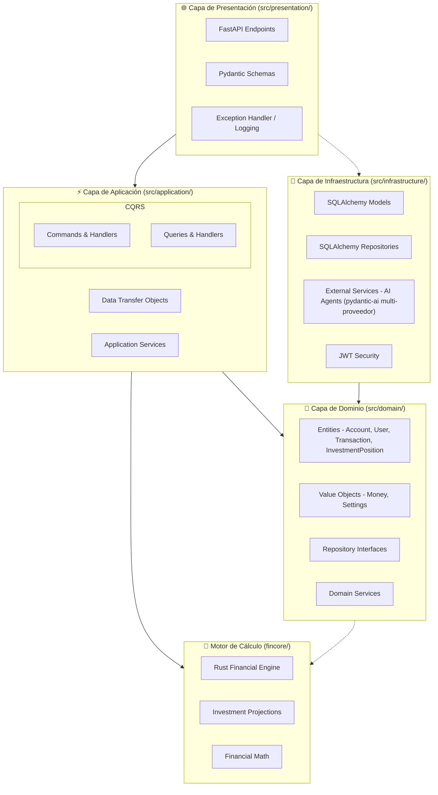
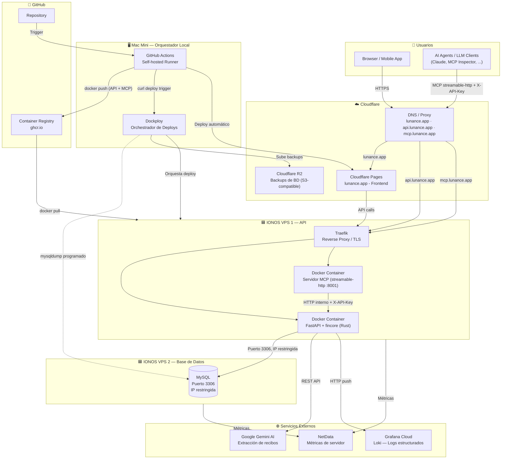
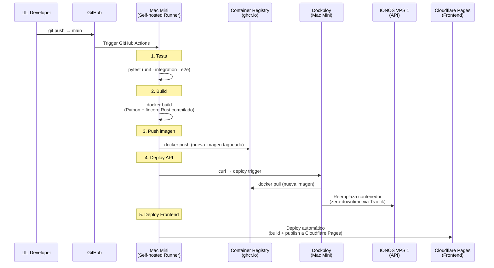
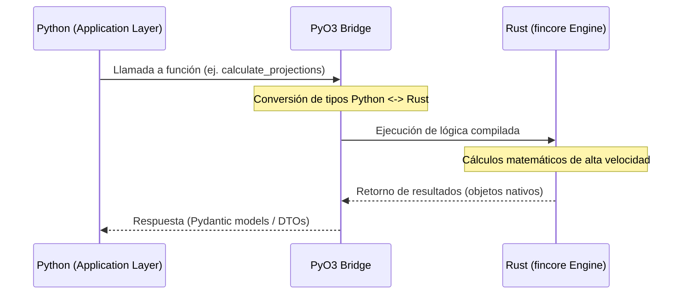
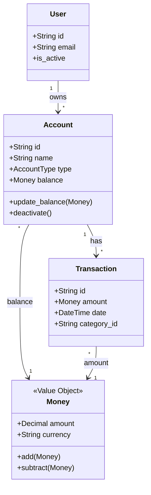
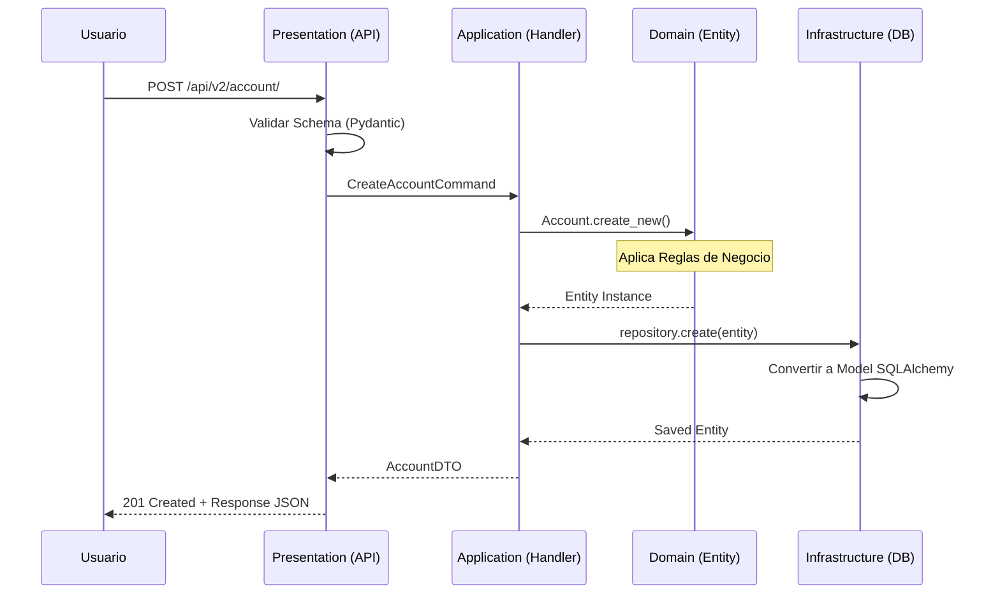
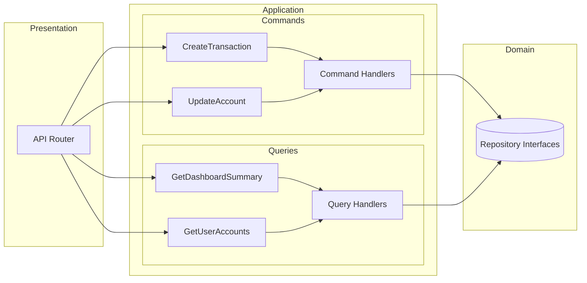
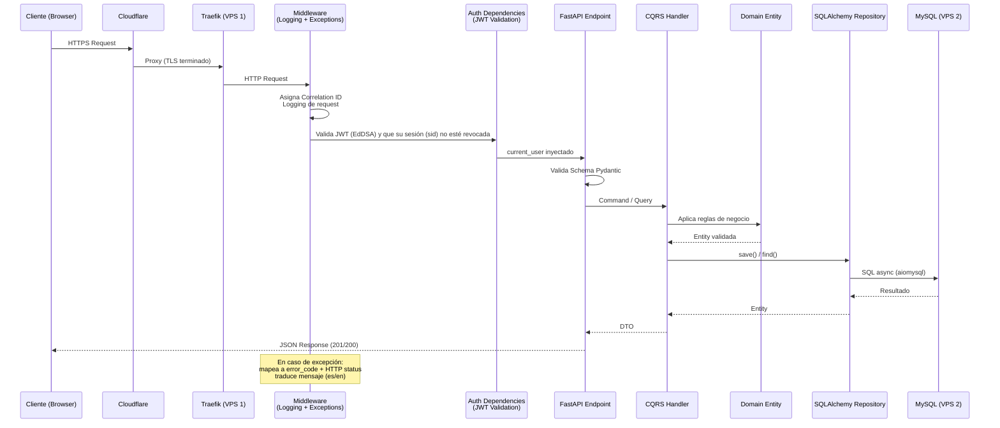

# 🏗️ Arquitectura Técnica - Lunance IA

> ⚠️ **Nota de contexto** — Las secciones `🏗️ Arquitectura de Infraestructura` y `🚀 Pipeline CI/CD` describen el sistema **tal y como estuvo desplegado** antes de retirar la operativa pública (`lunance.app` queda solo como landing page). Se conservan como **arquitectura de referencia** para quien quiera autohospedar el proyecto. Los nombres de host y proveedores (IONOS, Cloudflare, Dockploy, etc.) son ilustrativos: el backend es totalmente portable y se puede levantar con `docker compose up` sobre cualquier host con MySQL y Redis.

## Introducción

Este documento describe la arquitectura técnica detallada de Lunance IA, incluyendo la estructura interna de cada capa, patrones de diseño implementados, y las decisiones arquitectónicas tomadas para construir un sistema robusto y escalable.

## 🗺️ Visión General Visual



## 🏗️ Arquitectura de Infraestructura (referencia)

> ⚠️ **No describe un sistema en funcionamiento.** El despliegue público de Lunance IA fue retirado: `lunance.app` queda como landing page y los servicios de API y MCP ya no están disponibles. Esta sección se conserva como **arquitectura de referencia**: documenta cómo estuvo montado el sistema y sirve de guía a quien quiera autohospedarlo. Los nombres de host aparecen solo a título ilustrativo.

Vista del sistema tal y como estuvo desplegado, incluyendo todos los servicios y su comunicación.



### Descripción de Componentes

| Componente | Tecnología | Rol |
| :--- | :--- | :--- |
| **Cloudflare DNS/Proxy** | Cloudflare | DNS autoritativo + proxy para `lunance.app`, `api.lunance.app` y `mcp.lunance.app` (dominio comprado en IONOS). TLS extremo a extremo con **Cloudflare Origin Certificate** (SSL mode *Full (strict)*) |
| **Frontend** | Cloudflare Pages | SPA servida en el edge global |
| **Reverse Proxy** | Traefik (via Dockploy) | Terminación TLS, enrutamiento HTTP hacia los contenedores de la API y del MCP (por SNI: `api.*` y `mcp.*`) |
| **API Container** | Docker (FastAPI + fincore) | Contenedor principal de la aplicación en VPS 1 de IONOS |
| **MCP Container** | Docker (FastMCP, streamable-http) | Contenedor que expone la API como herramientas para agentes/LLM en `mcp.lunance.app` (puerto 8001). Actúa como **proxy**: reenvía cada llamada a la API por la red interna de Docker (`http://api:8000`) inyectando la `X-API-Key` del usuario y respetando sus scopes; no accede a la BD. Ver [MCP.md](MCP.md) |
| **Base de Datos** | MySQL en IONOS VPS 2 | Solo acepta conexiones desde la IP del VPS 1 (puerto 3306) y SSH |
| **Backups de BD** | Cloudflare R2 (S3-compatible) | Dockploy ejecuta dumps programados de MySQL y los sube a un bucket de R2, manteniendo las copias fuera de los VPS |
| **Autenticación** | Propia (JWT EdDSA + refresh opaco) | La API emite y valida sus propios tokens, con una sesión por dispositivo; no hay proveedor de identidad externo |
| **IA** | pydantic-ai multi-proveedor | Análisis de imágenes (recibos/tickets) y asesoría de gastos mediante agentes estructurados. Proveedor configurable vía `model_factory`: Google Gemini por defecto, con alternativas vía API compatible con OpenAI (Ollama, DeepSeek) |
| **Logs** | Grafana Cloud (Loki) | Ingesta de logs estructurados desde la API |
| **Métricas** | NetData | Métricas de infraestructura de ambos VPS |
| **Orquestador** | Dockploy (Mac Mini) | Gestiona el ciclo de vida de los contenedores en los VPS de IONOS |

---

## 🚀 Pipeline CI/CD (referencia)

> ⚠️ Igual que la sección anterior, describe el pipeline **tal y como estuvo operando**. GitHub Actions está desactivado en este repositorio y no hay despliegue automático activo. Los workflows se conservan en `.github/workflows/` como referencia.

El pipeline corría sobre un **runner self-hosted de GitHub Actions** en un **Mac Mini local**, que actuaba como runner y orquestador del deploy.



### Decisiones de Infraestructura

- **Self-hosted runner en Mac Mini**: Evita los costos de runners en la nube y aprovecha la potencia local para compilar el módulo Rust (`fincore`) que requiere tiempo de compilación.
- **Dockploy como orquestador**: Alternativa liviana a Kubernetes/ECS que gestiona contenedores en VPS sin costo adicional de plataforma.
- **VPS separado para DB**: Aislamiento de la base de datos con reglas de firewall estrictas (solo IP de la API y SSH).
- **Cloudflare Pages para Frontend**: CDN global sin costo, con deploy automático desde GitHub Actions.
- **Cloudflare DNS sobre IONOS**: Aprovecha el proxy de Cloudflare para protección DDoS y ocultamiento de IP del servidor, aunque el dominio esté comprado en IONOS.
- **Servidor MCP como contenedor independiente**: El MCP corre en su propio contenedor (`Dockerfile.mcp`) junto a la API en el VPS 1, comunicándose con ella por la red interna de Docker (`http://api:8000`) — nunca toca la BD directamente. Tiene su propio pipeline (workflows `stage-mcp-image.yml` / `prod-mcp-image.yml`, tags `mcp-stage` / `mcp-latest`), por lo que su ciclo de build y deploy es independiente del de la API.
- **TLS del MCP con Cloudflare Origin Certificate**: Como el transporte del MCP es *streamable-http* (conexiones de streaming), `mcp.lunance.app` se sirve proxied con un Origin Certificate instalado en Traefik y SSL mode *Full (strict)*, evitando la renovación HTTP-01 de Let's Encrypt (que falla estando tras el proxy).
- **Backups de BD gestionados por Dockploy hacia Cloudflare R2**: Dockploy ejecuta dumps programados de MySQL y los sube a un bucket de **Cloudflare R2** (almacenamiento de objetos S3-compatible), manteniendo las copias fuera de los VPS y sin costos de egress.

---

## 🦀 Arquitectura Híbrida (Python + Rust)

### Visión General

Lunance IA utiliza un enfoque híbrido para maximizar tanto la velocidad de desarrollo como el rendimiento computacional. Mientras que **Python** actúa como el orquestador principal (manejando la API, la lógica de negocio y la persistencia), **Rust** se encarga de los cálculos financieros pesados a través del módulo `fincore`.

> ⚠️ **Estado Beta**: La implementación de Rust está actualmente en fase beta. El objetivo a largo plazo es migrar todos los cálculos matemáticos y financieros críticos al motor de Rust para garantizar máxima precisión y velocidad.

### Flujo de Interacción



### 🎯 Responsabilidades por Lenguaje

| Característica | 🐍 Python (Orquestador) | 🦀 Rust (Motor Core) |
| :--- | :--- | :--- |
| **API & Routing** | FastAPI (Rápido desarrollo) | - |
| **Persistencia** | SQLAlchemy (Async MySQL) | - |
| **Lógica de Negocio** | CQRS, Reglas de Dominio | - |
| **Cálculos Financieros** | Orquestación | **Proyecciones de inversión** (`calculate_projections`, única función exportada hoy) |
| **Simulaciones** | - | *Roadmap futuro (no implementado): Monte Carlo, Escenarios* |
| **Validación Tipos** | Pydantic | **Tipado fuerte y memoria segura** |

### 🛠️ Integración Técnica

El módulo `fincore` se integra en el ecosistema Python utilizando:
- **PyO3**: Para crear bindings nativos de Rust para Python.
- **Maturin**: Como sistema de construcción y publicación del paquete Rust.
- **uv**: Maneja la instalación del módulo compilado de forma transparente.

## 📁 Estructura Detallada del Proyecto

### 🎯 Capa de Dominio (`src/domain/`)

La capa de dominio contiene la lógica de negocio pura sin dependencias externas.



```
domain/
├── entities/                          # Entidades de negocio con identidad
│   ├── __init__.py
│   ├── account.py                    # Entidad Account con reglas de negocio
│   ├── api_key.py                    # Entidad APIKey (acceso programático vía X-API-Key)
│   ├── bank.py                       # Entidad Bank (metadatos bancarios)
│   ├── budget.py                     # Entidad Budget (presupuestos por categoría)
│   ├── category.py                   # Entidad Category (clasificación de transacciones)
│   ├── dashboard.py                  # Entidad Dashboard (resumen financiero agregado)
│   ├── income_deposit.py             # Entidad IncomeDeposit (depósitos de ingresos)
│   ├── installment_charge.py         # Entidad InstallmentCharge (cargos de compras a plazos)
│   ├── installment_purchase.py       # Entidad InstallmentPurchase (compras a meses/plazos)
│   ├── investment_position.py        # Entidad InvestmentPosition (apartados: a la vista y a plazo)
│   ├── investment_yield.py           # Entidad InvestmentYield (rendimientos diarios por apartado)
│   ├── notification.py               # Entidad Notification (notificaciones al usuario)
│   ├── recurring_income.py           # Entidad RecurringIncome (ingresos recurrentes)
│   ├── refresh_token.py              # Entidad RefreshToken (hash del refresh opaco y su rotación)
│   ├── session.py                    # Entidad UserSession (una por dispositivo) y Platform
│   ├── auth_event.py                 # Entidad AuthEvent (auditoría de login, sesiones y cuenta)
│   ├── pending_signup.py             # PendingSignup (registro sin confirmar) y EmailVerificationToken
│   ├── password_reset_token.py       # PasswordResetToken (enlace de un solo uso)
│   ├── saving_goal.py                # Entidad SavingGoal (metas de ahorro)
│   ├── subscription.py              # Entidad Subscription (pagos recurrentes)
│   ├── subscription_charge.py       # Entidad SubscriptionCharge (cargos individuales)
│   ├── transaction.py               # Entidad Transaction con cálculos
│   └── user.py                      # Entidad User con validaciones
├── objects/                          # Value Objects inmutables
│   ├── __init__.py
│   ├── credit_card_settings.py      # Configuración de tarjetas de crédito
│   ├── enums.py                     # Enumeraciones de negocio (AccountType, InterestType, PositionType, PositionStatus, MaturityAction, etc.)
│   ├── frequency.py                 # Frecuencias y cálculo de ocurrencias (recurrencias)
│   └── money.py                     # Value Object Money con validaciones
├── repositories/                     # Interfaces abstractas para persistencia
│   ├── __init__.py
│   ├── account_repository.py        # Interface para operaciones de Account
│   ├── api_key_repository.py        # Interface para operaciones de APIKey
│   ├── session_repository.py        # Interface para sesiones por dispositivo
│   ├── refresh_token_repository.py  # Interface para refresh tokens (hash + rotación)
│   ├── auth_event_repository.py     # Interface para la auditoría de autenticación
│   ├── pending_signup_repository.py # Interface para registros pendientes y sus enlaces
│   ├── password_reset_token_repository.py # Interface para enlaces de recuperación (canje atómico)
│   ├── bank_repository.py           # Interface para operaciones de Bank
│   ├── budget_repository.py         # Interface para operaciones de Budget
│   ├── category_repository.py       # Interface para operaciones de Category
│   ├── credit_card_repository.py    # Interface para configuración de tarjetas de crédito
│   ├── dashboard_repository.py      # Interface para datos agregados del dashboard
│   ├── income_deposit_repository.py # Interface para depósitos de ingresos
│   ├── installment_charge_repository.py # Interface para cargos de compras a plazos
│   ├── installment_purchase_repository.py # Interface para compras a plazos
│   ├── investment_position_repository.py # Interface para apartados de inversión
│   ├── investment_yield_repository.py # Interface para rendimientos de inversión
│   ├── notification_repository.py   # Interface para notificaciones
│   ├── recurring_income_repository.py # Interface para ingresos recurrentes
│   ├── saving_goal_repository.py    # Interface para metas de ahorro
│   ├── subscription_charge_repository.py # Interface para cargos de suscripción
│   ├── subscription_repository.py   # Interface para operaciones de Subscription
│   ├── transaction_repository.py    # Interface para operaciones de Transaction
│   ├── unit_of_work.py              # Interface del patrón Unit of Work (AbstractUnitOfWork)
│   └── user_repository.py          # Interface para operaciones de User
└── services/                        # Servicios de dominio
    ├── __init__.py
    └── account_service.py           # Lógica compleja entre entidades
```

#### Características del Dominio:
- **Sin dependencias externas**: Solo usa tipos nativos de Python
- **Reglas de negocio centralizadas**: Todas las validaciones en un lugar
- **Inmutabilidad**: Value Objects son inmutables por diseño
- **Interfaces puras**: Contratos sin implementación específica
- **20 repositorios abstractos + Unit of Work**: Contratos completos para cada agregado, más `AbstractUnitOfWork` para transacciones atómicas

### ⚡ Capa de Aplicación (`src/application/`)

Orquesta casos de uso utilizando el patrón CQRS, organizada por feature/dominio.



```
application/
├── accounts/                  # Feature: Gestión de cuentas
│   ├── __init__.py
│   ├── commands/             # Operaciones de escritura de cuentas
│   │   ├── __init__.py
│   │   ├── create_account.py      # Crear cuenta (+ settings de crédito)
│   │   ├── update_account.py      # Actualizar cuenta
│   │   ├── delete_account.py      # Eliminar cuenta
│   │   └── state_account.py       # Cambiar estado de cuenta
│   └── queries/              # Operaciones de lectura de cuentas
│       ├── __init__.py
│       ├── get_account_by_id.py   # Consultar cuenta por ID
│       ├── get_user_accounts.py   # Consultar cuentas de usuario
│       └── get_account_activity.py # Consultar actividad reciente de la cuenta
├── transactions/             # Feature: Gestión de transacciones
│   ├── __init__.py
│   ├── commands/             # Operaciones de escritura de transacciones
│   │   ├── __init__.py
│   │   ├── create_transaction.py  # Crear transacción (afecta el saldo disponible de la cuenta)
│   │   ├── update_transaction.py
│   │   └── delete_transaction.py
│   └── queries/              # Operaciones de lectura de transacciones
│       ├── __init__.py
│       ├── get_transactions.py
│       └── get_transaction_by_uuid.py
├── subscriptions/            # Feature: Gestión de suscripciones
│   ├── __init__.py
│   ├── commands/
│   │   ├── __init__.py
│   │   ├── create_subscription.py
│   │   ├── update_subscription.py
│   │   ├── delete_subscription.py
│   │   └── state_subscription.py  # Activar/desactivar suscripción
│   ├── queries/
│   │   ├── __init__.py
│   │   ├── get_subscriptions.py
│   │   ├── get_subscriptions_by_id.py
│   │   ├── get_subscription_charges.py  # Historial de cargos
│   │   └── get_last_transactions.py     # Últimas transacciones de suscripciones
│   └── services/
│       └── subscription_processor.py    # Procesamiento automático de suscripciones
├── budgets/                  # Feature: Gestión de presupuestos
│   ├── __init__.py
│   ├── commands/
│   │   ├── __init__.py
│   │   ├── create_budget.py
│   │   ├── update_budget.py
│   │   ├── delete_budget.py
│   │   └── state_budget.py          # Activar/desactivar presupuesto
│   └── queries/
│       ├── __init__.py
│       ├── get_budgets.py
│       ├── get_budget_by_id.py
│       └── get_budget_progress.py   # Progreso de gasto vs presupuesto
├── goals/                    # Feature: Metas de ahorro
│   ├── __init__.py
│   ├── commands/
│   │   ├── __init__.py
│   │   ├── create_saving_goal.py
│   │   ├── update_saving_goal.py
│   │   ├── delete_saving_goal.py
│   │   └── state_saving_goal.py     # Activar/desactivar meta
│   └── queries/
│       ├── __init__.py
│       ├── get_saving_goals.py
│       └── get_saving_goal_by_id.py
├── incomes/                  # Feature: Ingresos recurrentes
│   ├── __init__.py
│   ├── commands/
│   │   ├── __init__.py
│   │   ├── create_recurring_income.py
│   │   ├── update_recurring_income.py
│   │   ├── delete_recurring_income.py
│   │   └── state_recurring_income.py
│   ├── queries/
│   │   ├── __init__.py
│   │   ├── get_recurring_incomes.py
│   │   ├── get_recurring_income_by_id.py
│   │   └── get_income_deposits.py   # Historial de depósitos
│   └── services/
│       ├── __init__.py
│       └── income_processor.py      # Procesamiento automático de ingresos
├── installments/             # Feature: Compras a plazos/meses
│   ├── __init__.py
│   ├── commands/
│   │   ├── __init__.py
│   │   ├── create_installment_purchase.py
│   │   ├── update_installment_purchase.py
│   │   ├── delete_installment_purchase.py
│   │   └── pay_installment_charge.py  # Pagar cargo individual
│   └── queries/
│       ├── __init__.py
│       └── get_installment_purchases.py
├── transfers/                # Feature: Transferencias entre cuentas
│   ├── __init__.py
│   ├── commands/
│   │   ├── __init__.py
│   │   ├── create_transfer.py
│   │   └── delete_transfer.py
│   └── queries/
│       ├── __init__.py
│       └── get_transactions.py      # Historial de transferencias
├── notifications/            # Feature: Notificaciones al usuario
│   ├── __init__.py
│   └── queries/
│       ├── __init__.py
│       └── get_and_clear_notifications.py  # Obtener y limpiar notificaciones
├── investments/              # Feature: Apartados de inversión y sus rendimientos
│   ├── __init__.py
│   ├── commands/
│   │   ├── __init__.py
│   │   ├── create_position.py           # Crear apartado (mueve dinero del disponible)
│   │   ├── update_position.py           # Nombre y configuración de tope/desbordamiento
│   │   ├── deposit_to_position.py       # Disponible -> apartado (solo a la vista)
│   │   ├── withdraw_from_position.py    # Apartado -> disponible (solo a la vista)
│   │   ├── liquidate_position.py        # Cerrar apartado, acreditar y reparar cadenas
│   │   ├── generate_daily_yields.py     # Rendimientos diarios por apartado (scheduled)
│   │   └── process_matured_positions.py # Vencimientos: renovar/liquidar/pendiente (scheduled)
│   ├── queries/
│   │   ├── __init__.py
│   │   ├── list_positions.py              # Apartados de una cuenta + disponible/invertido/total
│   │   ├── get_position.py                # Detalle de un apartado
│   │   ├── get_position_yields.py         # Rendimientos históricos del apartado
│   │   ├── get_position_projections.py    # Proyección del apartado (+ helper project_position)
│   │   ├── get_investment_yields.py       # Rendimientos históricos de la cuenta
│   │   └── get_investment_projections.py  # Proyección agregada de la cuenta
│   └── services/
│       └── position_overflow.py           # Cadena de desbordamiento: validar destino y repartir excedente
├── banks/                    # Feature: Catálogo de bancos
│   ├── __init__.py
│   └── queries/
│       ├── __init__.py
│       └── get_banks.py
├── auth/                     # Feature: Autenticación y sesiones por dispositivo
│   ├── __init__.py
│   ├── config.py             # AuthConfig (sesiones) y EmailAuthConfig (enlaces y vigencias)
│   ├── dto.py                # ClientContext (dispositivo, plataforma, IP) e IssuedSession
│   ├── emails.py             # Plantillas de los correos de cuenta (texto + HTML, en español)
│   ├── services/
│   │   ├── sessions.py       # SessionManager: abre sesiones y emite access + refresh
│   │   ├── login_guard.py    # LoginGuard: bloqueo por correo + IP y por correo
│   │   ├── signups.py        # Emite el enlace de verificación de un registro pendiente
│   │   ├── external_accounts.py # Google/Apple: cuenta vinculada, vinculación por buzón estable o alta
│   │   └── apple_tokens.py   # Refresh token de Apple cifrado y AppleAuthorizationRevoker
│   ├── commands/
│   │   ├── __init__.py
│   │   ├── login.py          # Login por correo: throttle, verifica contraseña, re-hashea bcrypt → Argon2, abre sesión
│   │   ├── logout.py         # Cerrar esta sesión o todas (`all_devices`)
│   │   ├── refresh_session.py # Rotación del refresh con gracia y detección de reuso
│   │   ├── revoke_session.py # Cerrar una sesión propia desde otro dispositivo
│   │   ├── purge_auth_data.py # Job diario: sesiones viejas, auditoría, registros y enlaces vencidos
│   │   ├── register.py       # Registro pendiente + correo de verificación (anti-enumeración)
│   │   ├── verify_email.py   # Confirmar el correo (crea la cuenta) y reenviar el enlace
│   │   ├── password_reset.py # "Olvidé mi contraseña" y restablecerla (cierra todas las sesiones)
│   │   ├── change_password.py # Cambiar la contraseña con sesión (cierra las demás)
│   │   ├── change_username.py # Cambiar el username (PATCH /auth/me)
│   │   ├── provider_sign_in.py # Entrar con Google o Apple (token de un solo uso, canje del código de Apple)
│   │   ├── link_provider.py  # Vincular/desvincular Google o Apple desde ajustes
│   │   └── apple_notifications.py # Avisos servidor a servidor de Apple
│   └── queries/
│       └── list_sessions.py  # Sesiones activas, con la actual marcada
├── api_keys/                 # Feature: API keys (acceso programático / MCP)
│   ├── __init__.py
│   ├── commands/
│   │   ├── __init__.py
│   │   ├── create_api_key.py
│   │   ├── delete_api_key.py
│   │   └── revoke_api_key.py
│   └── queries/
│       ├── __init__.py
│       └── list_api_keys.py
├── categories/               # Feature: Gestión de categorías
│   ├── __init__.py
│   └── queries/
│       ├── __init__.py
│       └── get_categories.py
├── dashboard/                # Feature: Dashboard y resumen
│   ├── __init__.py
│   └── queries/
│       ├── __init__.py
│       └── get_dashboard_summary.py
├── ai/                       # Feature: Agentes de IA
│   ├── __init__.py
│   ├── queries/
│   │   ├── __init__.py
│   │   ├── analyze_image.py      # Analiza imágenes de recibos/tickets
│   │   └── expense_advisor.py    # Análisis y recomendaciones de gastos del mes
│   └── schemas/
│       ├── __init__.py
│       ├── image_analysis.py     # Schema de respuesta del análisis de imagen
│       └── expense_analysis.py   # Schema de respuesta del asesor de gastos
├── dto/                      # Data Transfer Objects (compartidos)
│   ├── __init__.py
│   ├── account_dto.py
│   ├── api_key_dto.py
│   ├── bank_dto.py
│   ├── budget_dto.py
│   ├── category_dto.py
│   ├── installment_dto.py
│   ├── investment_yield_dto.py
│   ├── recurring_income_dto.py
│   ├── saving_goal_dto.py
│   ├── subscription_dto.py
│   └── transaction_dto.py
└── interfaces/               # Interfaces de aplicación
    ├── ai_agent.py           # Contrato del agente IA (AIAgentInterface)
    ├── auth_service.py       # Contratos de auth: AccessTokenIssuer, PasswordHasher, SessionRevocationList, LoginThrottle
    ├── email.py              # OutgoingEmail, EmailSender (puerto de envío) y EmailQueue (envío tras el commit)
    ├── identity_providers.py # Google/Apple: verificadores, AppleSignInGateway, UsedProviderTokens, SecretCipher
    └── uploaded_file.py      # Contrato de archivo subido (UploadedFileInterface)
```

#### Características de Aplicación:
- **Organización por Feature**: Cada dominio tiene su propia carpeta con comandos y queries
- **Separación CQRS**: Comandos (escritura) y queries (lectura) claramente separados
- **DTOs Centralizados**: Objetos de transferencia compartidos entre features
- **Handlers**: Cada comando/consulta tiene su handler específico
- **Services**: Lógica de aplicación compleja (ej. `SubscriptionProcessor` para procesamiento automático)
- **Scheduled Jobs**: `GenerateDailyYieldHandler` para cálculo diario de rendimientos
- **Agentes IA**: `AnalyzeImageHandler` y `GetExpenseAdvisorHandler` encapsulan la lógica de análisis con agentes IA (pydantic-ai)
- **Interfaces**: `AIAgentInterface` y `AuthTokenServiceInterface` desacoplan la aplicación de las implementaciones concretas de infraestructura
- **Nomenclatura limpia**: Los nombres de archivos no repiten "command" o "query" ya que la carpeta provee el contexto

### 🔧 Capa de Infraestructura (`src/infrastructure/`)

Implementa todos los detalles técnicos y servicios externos.

```
infrastructure/
├── database/                  # Persistencia de datos
│   ├── __init__.py
│   ├── connection.py          # Configuración de conexión SQLAlchemy (async)
│   ├── models/               # Modelos de base de datos (SQLAlchemy ORM)
│   │   ├── __init__.py
│   │   ├── account.py        # Modelo Account
│   │   ├── api_key.py        # Modelo APIKey
│   │   ├── bank.py           # Modelo Bank
│   │   ├── budget.py         # Modelo Budget
│   │   ├── category.py       # Modelo Category
│   │   ├── credit_card.py    # Modelo CreditCard (settings)
│   │   ├── installment.py    # Modelos InstallmentPurchase e InstallmentCharge
│   │   ├── investment_position.py # Modelo InvestmentPosition (apartados)
│   │   ├── investment_yield.py    # Modelo InvestmentYield (rendimientos por apartado)
│   │   ├── notifications.py  # Modelo Notification
│   │   ├── recurring_income.py # Modelos RecurringIncome e IncomeDeposit
│   │   ├── refresh_token.py  # Modelo RefreshToken (token_hash PK → user_sessions)
│   │   ├── user_session.py   # Modelo UserSession (una por dispositivo)
│   │   ├── auth_event.py     # Modelo AuthEvent (auditoría)
│   │   ├── pending_signup.py # Modelos PendingSignup y EmailVerificationToken
│   │   ├── password_reset_token.py # Modelo PasswordResetToken
│   │   ├── reminder.py       # Modelo Reminder
│   │   ├── saving_goal.py    # Modelo SavingGoal
│   │   ├── subscription.py   # Modelo Subscription
│   │   ├── tag.py            # Modelo Tag
│   │   ├── transaction.py    # Modelo Transaction
│   │   └── user.py           # Modelo User
│   └── repositories/         # Implementaciones concretas de repositorios
│       ├── __init__.py
│       ├── sqlalchemy_account_repository.py
│       ├── sqlalchemy_api_key_repository.py
│       ├── sqlalchemy_auth_event_repository.py
│       ├── sqlalchemy_bank_repository.py
│       ├── sqlalchemy_budget_repository.py
│       ├── sqlalchemy_category_repository.py
│       ├── sqlalchemy_credit_card_repository.py
│       ├── sqlalchemy_dashboard_repository.py
│       ├── sqlalchemy_income_deposit_repository.py
│       ├── sqlalchemy_installment_charge_repository.py
│       ├── sqlalchemy_installment_purchase_repository.py
│       ├── sqlalchemy_investment_position_repository.py
│       ├── sqlalchemy_investment_yield_repository.py
│       ├── sqlalchemy_notification_repository.py
│       ├── sqlalchemy_password_reset_token_repository.py
│       ├── sqlalchemy_pending_signup_repository.py
│       ├── sqlalchemy_recurring_income_repository.py
│       ├── sqlalchemy_refresh_token_repository.py
│       ├── sqlalchemy_saving_goal_repository.py
│       ├── sqlalchemy_session_repository.py
│       ├── sqlalchemy_subscription_charge_repository.py
│       ├── sqlalchemy_subscription_repository.py
│       ├── sqlalchemy_transaction_repository.py
│       ├── sqlalchemy_unit_of_work.py   # Unit of Work (transacciones atómicas)
│       └── sqlalchemy_user_repository.py
├── external_services/         # Integraciones con servicios externos
│   ├── __init__.py
│   ├── agents/               # Agentes IA estructurados (pydantic-ai)
│   │   ├── __init__.py
│   │   ├── image.py          # Agente de análisis de imágenes (recibos/tickets)
│   │   ├── expense.py        # Agente asesor de gastos del mes
│   │   └── model_factory.py  # Factory multi-proveedor (Google Gemini; Ollama y DeepSeek vía API compatible con OpenAI)
│   └── email/                # Implementaciones de EmailSender
│       ├── resend.py         # ResendEmailSender: API HTTP de Resend con httpx (producción)
│       ├── smtp.py           # SmtpEmailSender: SMTP (Mailpit en local), smtplib en un hilo
│       ├── memory.py         # InMemoryEmailSender: buzón en memoria (tests)
│       ├── delivery.py       # deliver(): envío en segundo plano; los fallos solo van al log
│       └── factory.py        # build_email_sender(settings) según EMAIL_BACKEND
├── security/                 # Servicios de seguridad
│   ├── __init__.py
│   ├── jwt_tokens.py         # EdDSATokenIssuer: access tokens JWT Ed25519 (sub + sid)
│   ├── jwks.py               # JwksCache: claves públicas de Google/Apple con Cache-Control y refresco limitado
│   ├── id_tokens.py          # Comprobación común de ID tokens RS256 (iss, aud, exp/iat, nonce)
│   ├── google_id_tokens.py   # GoogleIdTokenVerifier (web, iOS y Android)
│   ├── apple_sign_in.py      # AppleSignInClient: identity token, canje del código (ES256), revocación y avisos
│   ├── secret_cipher.py      # AesGcmSecretCipher: secretos en la base con AES-256-GCM (HKDF)
│   ├── passwords.py          # Argon2PasswordHasher (verifica también bcrypt heredado)
│   └── api_key_service.py    # APIKeyService: emisión y validación de API keys
├── scheduler/                # Tareas programadas
│   ├── __init__.py
│   ├── jobs.py               # Definición de jobs (suscripciones, rendimientos, vencimientos de apartados, ingresos recurrentes, purga de sesiones, registros y enlaces)
│   └── service.py            # SchedulerService (APScheduler wrapper)
├── cache/                    # Cliente de Redis compartido (init/close en el lifespan)
│   ├── redis.py
│   ├── login_throttle.py     # RedisLoginThrottle: bloqueo progresivo del login (fail-closed)
│   ├── session_revocations.py # Lista revoked_sid:<uuid> en Redis, con MySQL como autoridad
│   └── provider_tokens.py    # ID tokens de Google/Apple ya usados (un solo uso, fail-closed)
├── rate_limiting/            # Rate limiting por endpoint sobre Redis
│   ├── __init__.py
│   ├── client_ip.py          # IP real del cliente (CLIENT_IP_HEADER) e identidad por IP (IPv6 por /64)
│   └── limiters.py           # RedisRateLimiter, reglas limiter_N_per_X y helper async enforce_rate_limit
├── logging/                  # Sistema de logging estructurado
│   ├── __init__.py
│   ├── context.py            # Request correlation IDs
│   ├── filters.py            # Filtros de log personalizados
│   ├── formatters.py         # Formateadores de log
│   └── providers/            # Proveedores de log
│       ├── __init__.py
│       ├── base.py           # Provider base
│       └── grafana_loki.py   # Integración con Grafana Loki
└── config/                   # Configuración de aplicación
    ├── __init__.py
    ├── logging_config.py     # Configuración centralizada de logging
    └── settings.py           # Variables de entorno (pydantic-settings)
```

#### Características de Infraestructura:
- **Implementaciones concretas**: 22 repositorios SQLAlchemy + Unit of Work implementando interfaces del dominio
- **Adaptadores**: Para servicios externos (agentes IA con pydantic-ai multi-proveedor)
- **Scheduler**: APScheduler con AsyncIOScheduler para jobs diarios (suscripciones 00:00, ingresos 00:15, rendimientos 12:00 y vencimientos de apartados 12:30, en UTC; los vencimientos corren después de los rendimientos para que el día del vencimiento aún genere interés)
- **Logging estructurado**: Correlation IDs, filtros personalizados, integración Grafana Loki
- **Configuración**: Variables de entorno con pydantic-settings
- **Persistencia async**: Modelos SQLAlchemy con AsyncSession (aiomysql driver)

### 🌐 Capa de Presentación (`src/presentation/`)

Expone la aplicación através de API REST.

```
presentation/
├── api/
│   └── v2/                        # API versión 2 con Clean Architecture
│       ├── __init__.py
│       ├── endpoints/             # Endpoints específicos por dominio
│       │   ├── __init__.py
│       │   ├── auth.py            # Autenticación (register, login, refresh, logout, me)
│       │   ├── account.py         # CRUD cuentas + activación/desactivación
│       │   ├── transaction.py     # CRUD transacciones
│       │   ├── transfer.py        # Transferencias entre cuentas
│       │   ├── subscription.py    # CRUD suscripciones + cargos + activación
│       │   ├── budget.py          # CRUD presupuestos + progreso
│       │   ├── goals.py           # CRUD metas de ahorro + activación
│       │   ├── income.py          # CRUD ingresos recurrentes + depósitos
│       │   ├── installment.py     # Compras a plazos + pago de cargos
│       │   ├── notification.py    # Notificaciones del usuario
│       │   ├── investment_yield.py # Rendimientos y proyecciones por cuenta
│       │   ├── investment_position.py # Apartados: CRUD + depositar/retirar/liquidar
│       │   ├── bank.py            # Catálogo de bancos
│       │   ├── category.py        # Catálogo de categorías
│       │   ├── dashboard.py       # Resumen financiero
│       │   ├── api_key.py         # Gestión de API keys (crear, listar, revocar)
│       │   └── ai.py              # Análisis IA (POST /analyze/image, asesor de gastos)
│       └── router.py             # Router principal que agrupa endpoints
├── schemas/                      # Schemas Pydantic para validación
│   ├── requests/                 # DTOs de entrada (requests)
│   │   ├── __init__.py
│   │   ├── auth.py              # Schemas para requests de auth
│   │   ├── account.py           # Schemas para requests de cuenta
│   │   ├── api_key.py           # Schemas para requests de API keys
│   │   ├── budget.py            # Schemas para requests de presupuesto
│   │   ├── installment.py       # Schemas para requests de compras a plazos
│   │   ├── investment_position.py # Schemas para requests de apartados
│   │   ├── recurring_income.py  # Schemas para requests de ingresos recurrentes
│   │   ├── saving_goal.py       # Schemas para requests de metas de ahorro
│   │   ├── subscription.py     # Schemas para requests de suscripción
│   │   ├── transaction.py      # Schemas para requests de transacción
│   │   └── transfer.py         # Schemas para requests de transferencia
│   └── responses/                # DTOs de salida (responses)
│       ├── __init__.py
│       ├── auth.py              # Schemas para responses de auth
│       ├── account.py           # Schemas para responses de cuenta
│       ├── api_key.py           # Schemas para responses de API keys
│       ├── bank.py              # Schemas para responses de banco
│       ├── budget.py            # Schemas para responses de presupuesto
│       ├── category.py          # Schemas para responses de categoría
│       ├── error.py             # Schema estandarizado de errores
│       ├── installment.py       # Schemas para responses de compras a plazos
│       ├── investment_yield.py  # Schemas para rendimientos/proyecciones
│       ├── investment_position.py # Schemas para responses de apartados
│       ├── notification.py      # Schemas para responses de notificaciones
│       ├── recurring_income.py  # Schemas para responses de ingresos recurrentes
│       ├── saving_goal.py       # Schemas para responses de metas de ahorro
│       ├── subscription.py      # Schemas para responses de suscripción
│       ├── transaction.py       # Schemas para responses de transacción
│       └── transfer.py          # Schemas para responses de transferencia
├── dependencies/                 # Inyección de dependencias FastAPI
│   ├── __init__.py
│   ├── auth_deps.py             # Dependencias de autenticación (JWT, usuario activo)
│   ├── auth_handler_deps.py     # Factories de handlers de auth
│   ├── auth_services.py         # Issuer JWT, hasher, AuthConfig/EmailAuthConfig y LoginGuard
│   ├── email_deps.py            # EmailSender (lru_cache) y cola de correo con BackgroundTasks
│   ├── identity_deps.py         # Verificadores de Google/Apple (None si no están configurados) y sus handlers
│   ├── repositories.py          # Factories de repositorios
│   ├── services.py              # Factories de servicios
│   ├── account_deps.py          # Factories de handlers de cuentas
│   ├── transaction_deps.py      # Factories de handlers de transacciones
│   ├── transfer_deps.py         # Factories de handlers de transferencias
│   ├── subscription_deps.py     # Factories de handlers de suscripciones
│   ├── budget_deps.py           # Factories de handlers de presupuestos
│   ├── saving_goal_deps.py      # Factories de handlers de metas de ahorro
│   ├── recurring_income_deps.py # Factories de handlers de ingresos recurrentes
│   ├── installment_deps.py      # Factories de handlers de compras a plazos
│   ├── notification_deps.py     # Factories de handlers de notificaciones
│   ├── investment_yield_deps.py # Factories de handlers de inversiones
│   ├── investment_position_deps.py # Factories de handlers de apartados
│   ├── bank_deps.py             # Factories de handlers de bancos
│   ├── category_deps.py         # Factories de handlers de categorías
│   ├── dashboard_deps.py        # Factories de handlers de dashboard
│   ├── api_key_deps.py          # Factories de handlers de API keys
│   └── ai_deps.py               # Factories de handlers de agentes IA
├── mcp/                          # Servidor MCP (Model Context Protocol)
│   ├── __init__.py
│   ├── server.py                # Servidor FastMCP (streamable-http, proxy hacia la API)
│   ├── client.py                # Cliente HTTP interno hacia la API (inyecta X-API-Key)
│   └── config.py                # Configuración del servidor MCP
└── middleware/                   # Middleware HTTP
    ├── __init__.py
    ├── exception_handler.py     # Manejador global de excepciones estandarizado
    └── request_logging.py       # Middleware de logging de requests HTTP
```

#### Características de Presentación:
- **API REST**: 17 módulos de endpoints organizados por dominio
- **Validación**: Schemas Pydantic para entrada y salida
- **Dependency Injection**: Sistema granular de DI de FastAPI (un archivo por feature)
- **Rate Limiting**: Protección por endpoint con ventana fija sobre Redis (`RedisRateLimiter`)
- **Versionado**: API v2 para nueva arquitectura
- **Middleware**: Logging de requests + manejo estandarizado de excepciones

### 🔄 Recursos Compartidos (`src/shared/`)

Utilidades y recursos transversales a todas las capas.

```
shared/
├── exceptions/              # Sistema de excepciones personalizado
│   ├── __init__.py
│   ├── base.py             # Excepciones base del sistema (LunanceException)
│   ├── domain.py           # Excepciones de dominio (NotFound, InsufficientFunds, etc.)
│   └── application.py      # Excepciones de aplicación (CommandValidation, JWT, etc.)
├── constants/              # Constantes de negocio
│   ├── __init__.py
│   ├── business.py         # Constantes de reglas de negocio
│   ├── error_messages.py   # ⚠️ DEPRECADO - usar validation_messages.py
│   └── validation_messages.py # Mensajes de validación y traducción
├── i18n/                   # Internacionalización
│   └── messages.py         # Sistema de traducción de mensajes (es/en)
├── utils/                  # Utilidades generales
│   ├── __init__.py
│   ├── money.py           # Utilidades para manejo monetario
│   ├── date.py            # Utilidades para fechas
│   ├── language.py        # Detección de idioma del usuario (Accept-Language)
│   ├── prompts.py         # Prompts para los agentes IA (análisis de imagen, asesor de gastos)
│   └── validations.py     # Funciones de validación comunes
└── validators/             # Validadores de negocio
    ├── __init__.py
    └── business.py         # UserValidator, EmailValidator, PasswordValidator
```

### 🧪 Testing (`src/tests/`)

Estrategia de testing por capas.

```
tests/
├── conftest.py             # Configuración global de pytest y fixtures compartidos
├── TEST.md                 # Documentación de testing
├── unit/                  # Pruebas unitarias (sin dependencias externas)
│   ├── domain/            # Tests de la capa de dominio
│   └── application/       # Tests de casos de uso
├── integration/           # Pruebas de integración (con BD)
├── e2e/                   # Pruebas end-to-end (flujos completos vía API)
└── stress/                # Pruebas de carga con Locust
    └── locustfile.py      # Definición de escenarios de carga
```

## 🔄 Patrones de Diseño Implementados

### 1. Clean Architecture

**Inversión de Dependencias**: Las capas externas dependen de las internas.

```
┌─────────────────────────────────────────────────────────┐
│                    Frameworks & Drivers                 │
│              (FastAPI, SQLAlchemy, MySQL)               │
├─────────────────────────────────────────────────────────┤
│                Interface Adapters                       │
│            (Controllers, Repositories)                  │
├─────────────────────────────────────────────────────────┤
│                 Application Business Rules              │
│                    (Use Cases)                          │
├─────────────────────────────────────────────────────────┤
│                Enterprise Business Rules                │
│                   (Entities)                           │
└─────────────────────────────────────────────────────────┘
```

### 2. CQRS (Command Query Responsibility Segregation)

Separación entre operaciones de lectura y escritura, organizadas por feature:



```python
# application/accounts/commands/create_account.py
# Comando - Operación de escritura
@dataclass
class CreateAccountCommand:
    user_id: str
    name: str
    account_type: AccountType
    bank: Optional[str] = None
    initial_balance: Decimal = Decimal('0.00')

# Handler del comando
class CreateAccountHandler:
    def __init__(self, account_repo: AccountRepository):
        self._account_repo = account_repo

    async def handle(self, command: CreateAccountCommand) -> Account:
        # Lógica de creación
        pass

# application/accounts/queries/get_user_accounts.py
# Consulta - Operación de lectura
@dataclass
class GetUserAccountsQuery:
    user_id: str
    include_inactive: bool = False

# Handler de la consulta
class GetUserAccountsHandler:
    def __init__(self, account_repo: AccountRepository):
        self._account_repo = account_repo

    async def handle(self, query: GetUserAccountsQuery) -> List[Account]:
        # Lógica de consulta
        pass

# Ejemplo de uso en endpoints
# presentation/api/v2/endpoints/account.py
from application.accounts.commands.create_account import (
    CreateAccountCommand,
    CreateAccountHandler
)
from application.accounts.queries.get_user_accounts import (
    GetUserAccountsQuery,
    GetUserAccountsHandler
)
```

### 3. Repository Pattern

Abstracción de la persistencia de datos:

```python
# Interface abstracta en Domain
from abc import ABC, abstractmethod

class AccountRepository(ABC):
    @abstractmethod
    async def create(self, account: Account) -> Account:
        pass

    @abstractmethod
    async def get_by_id(self, account_id: int) -> Optional[Account]:
        pass

    @abstractmethod
    async def get_by_user_id(self, user_id: int) -> List[Account]:
        pass

    @abstractmethod
    async def delete(self, account: Account) -> bool:
        pass

# Implementación concreta en Infrastructure
class SQLAlchemyAccountRepository(AccountRepository):
    def __init__(self, db: AsyncSession):
        self.db = db

    @staticmethod
    def _model_to_entity(model: AccountModel) -> Account:
        """Convierte un modelo SQLAlchemy a entidad de dominio"""
        return Account(
            id=model.id,
            uuid=model.uuid,
            user_id=model.user_id,
            # ... resto de campos
        )

    @staticmethod
    def _entity_to_model(entity: Account) -> AccountModel:
        """Convierte una entidad de dominio a modelo SQLAlchemy"""
        return AccountModel(
            user_id=entity.user_id,
            # ... resto de campos
        )

    async def create(self, account: Account) -> Account:
        model = self._entity_to_model(account)
        self.db.add(model)
        await self.db.flush()      # El commit lo gestiona el Unit of Work
        await self.db.refresh(model)
        return self._model_to_entity(model)

    # ... otras implementaciones
```

### 4. Value Objects

Objetos inmutables con reglas de negocio:

```python
from dataclasses import dataclass
from decimal import Decimal

from shared.exceptions.domain import (
    InsufficientFundsError,
    NegativeAmountError,
    CurrencyMismatchError,
)

@dataclass(frozen=True)
class Money:
    """Value Object to represent a Money"""

    amount: Decimal
    currency: str = "MXN"

    def __post_init__(self):
        if self.amount < 0:
            raise NegativeAmountError(float(self.amount))

    def add(self, other: "Money") -> "Money":
        if self.currency != other.currency:
            raise CurrencyMismatchError(self.currency, other.currency)
        return Money(self.amount + other.amount, self.currency)

    def subtract(self, other: "Money") -> "Money":
        if self.currency != other.currency:
            raise CurrencyMismatchError(self.currency, other.currency)
        result_amount = self.amount - other.amount
        if result_amount < 0:
            raise InsufficientFundsError(
                required_amount=float(other.amount),
                available_amount=float(self.amount),
            )
        return Money(result_amount, self.currency)

    def __str__(self):
        return f"{self.amount:.2f} {self.currency}"
```

> Las operaciones lanzan **excepciones de dominio** (`NegativeAmountError`, `CurrencyMismatchError`, `InsufficientFundsError`), no `ValueError`: así el exception handler las traduce a códigos de error estandarizados.

### 5. Domain Entities

Entidades con identidad y comportamiento:

```python
from dataclasses import dataclass
from datetime import datetime, timezone
from decimal import Decimal
from typing import Optional, cast

@dataclass
class Account:
    id: Optional[int]              # ID autoincremental (None hasta persistir)
    uuid: Optional[str]            # UUID público expuesto por la API
    user_id: int
    bank_id: int
    name: str
    account_type: AccountType
    current_balance: Money      # Saldo disponible (no incluye apartados de inversión)
    is_active: bool
    creation_date: datetime
    credit_card_settings: Optional[CreditCardSettings] = None

    @classmethod
    def create_new(
        cls,
        user_id: int,
        bank_id: int,
        name: str,
        account_type: AccountType,
        initial_balance: Optional[Money] = None,
    ) -> "Account":
        """Factory method para crear nueva cuenta"""
        if initial_balance is None:
            initial_balance = Money(Decimal(0), "MXN")

        return cls(
            id=None,
            uuid=None,
            user_id=user_id,
            bank_id=bank_id,
            name=name,
            account_type=account_type,
            current_balance=initial_balance,
            is_active=True,
            creation_date=datetime.now(timezone.utc),
        )

    def deactivate(self) -> None:
        """Desactiva la cuenta"""
        self.is_active = False

    def activate(self) -> None:
        """Reactiva la cuenta"""
        self.is_active = True

    def update_balance(self, new_balance: Money) -> None:
        """Actualiza el balance con validaciones de negocio"""
        if new_balance.currency != self.current_balance.currency:
            raise InvalidBalanceUpdateError(
                "Currencies must be the same to update balance"
            )
        if not self.is_active:
            raise AccountInactiveError(cast(int, self.id))
        if new_balance.amount < 0 and self.account_type != AccountType.CREDIT_CARD:
            # Solo las tarjetas de crédito pueden tener balance negativo
            raise InvalidBalanceUpdateError(self.account_type)
        self.current_balance = new_balance

    def can_withdraw(self, amount: Money) -> bool:
        """Verifica si se puede retirar el monto especificado"""
        return self.current_balance.amount >= amount.amount
```

#### Apartados de inversión (`InvestmentPosition`)

Un apartado es una porción de dinero **dentro de una cuenta** que genera rendimientos, con
su propio saldo, tasa y plazo. Es el equivalente a las "cajitas" de las apps bancarias y
las inversiones a plazo de las SOFIPOs. Una cuenta puede tener N apartados.

**La invariante central:** `Account.current_balance` es **solo el saldo disponible**. El
dinero de los apartados vive en `InvestmentPosition.balance`, así que el total de una
cuenta (`disponible + suma de apartados`) siempre se calcula, nunca se almacena.

De esa decisión se derivan dos propiedades que el diseño garantiza *por construcción*, sin
validaciones extra: las transferencias, los gastos y `can_withdraw` solo leen
`current_balance`, por lo que **no pueden tocar el dinero apartado**; y para gastarlo hay
que regresarlo antes al disponible con `withdraw` o `liquidate`.

La entidad encapsula las reglas de negocio del apartado:

| Método | Regla que encapsula |
|--------|---------------------|
| `accrue_yield()` | A la vista capitaliza en `balance`; a plazo fijo acumula en `accrued_yield`. Devuelve lo que no cupo bajo el tope |
| `deposit()` / `withdraw()` | Solo apartados a la vista; un plazo fijo los rechaza. `deposit()` devuelve el excedente |
| `liquidate()` | Devuelve el monto a acreditar; si es anticipada aplica la penalización **solo sobre los rendimientos** (el capital nunca se toca) y rechaza si sigue el periodo de permanencia |
| `renew()` | Reinvierte capital + rendimiento por el mismo plazo (`AUTO_RENEW`) |
| `mark_matured()` | Deja el apartado en `MATURED`: deja de rendir y espera la decisión del usuario (`HOLD`) |
| `configure_cap()` | Cambia tope y destino; devuelve el excedente a desbordar de inmediato |
| `clear_overflow_target()` | El destino desapareció: el excedente pasa al disponible |

Los movimientos de dinero (crear, depositar, retirar, liquidar) bloquean filas siempre en
el mismo orden — **cuenta → apartado** — para evitar deadlocks entre sí y con los jobs
programados. Cada movimiento genera además una transacción tipo `TRANSFER` con
`position_id`, de modo que el dinero apartado sea trazable desde la actividad de la cuenta.

**Topes y desbordamiento.** Un apartado a la vista puede tener un tope (`max_balance`) y
un destino para lo que ya no cabe: el saldo disponible o **otro apartado**. Encadenarlos
es como se representan las tasas por tramo de las SOFIPOs (25,000 al 10% desbordando a
otro apartado al 5%), sin que la entidad tenga que entender de tramos.

`PositionOverflowService` (`application/investments/services/`) es el único lugar que
recorre esa cadena, en sus dos momentos: `validate_target()` al configurarla —destino
existente, de la misma cuenta, a la vista, activo y sin ciclos— y `spill()` en ejecución,
repartiendo el excedente hasta que algún apartado lo absorba o caiga al disponible.
`spill()` nunca lanza excepción: una cadena rota no puede tumbar el job diario ni perder
dinero, así que un destino liquidado, un ciclo en base de datos o una cadena demasiado
larga terminan igual — log de error y el dinero al saldo disponible. Los locks se toman
siguiendo las aristas de la cadena, que es acíclica, así que dos cascadas concurrentes no
pueden bloquearse mutuamente.

La consecuencia operativa del tope está en el job de rendimientos: un apartado que vive en
su tope sigue rindiendo y desborda **todos los días**. Por eso `generate_daily_yields`
toca el saldo de la cuenta y crea transacciones, cosa que antes no hacía.

### 6. Unit of Work

Coordinación de transacciones atómicas entre múltiples repositorios. La interfaz `AbstractUnitOfWork` vive en el dominio (`domain/repositories/unit_of_work.py`) y su implementación `SQLAlchemyUnitOfWork` en infraestructura. Los handlers la usan como context manager: los repositorios hacen `flush()` y el `commit()` (o `rollback()` en caso de error) se ejecuta al salir del bloque:

```python
# En un command handler
async with self.uow:
    saved_account = await self.account_repository.create(account)
    await self.credit_card_settings_repository.create(saved_account.id, settings)
    await self.uow.commit()  # Confirmación atómica de todas las operaciones
```

### 7. Idempotencia (`Idempotency-Key`)

Un reintento de la app (se cortó la señal antes de la respuesta) nunca debe duplicar un
movimiento de dinero. Los `POST` que crean recursos exigen el header `Idempotency-Key`
(UUID) y los `PUT`/`PATCH`/`DELETE` lo aceptan; el contrato para clientes está en
[API_USAGE.md](API_USAGE.md#-idempotencia-idempotency-key).

| Capa | Pieza |
|------|-------|
| Aplicación | `application/interfaces/idempotency.py` (contrato del almacén), `application/idempotency/service.py` (`IdempotencyService`, el flujo) y `commands/purge_idempotency_keys.py` |
| Infraestructura | Tabla `idempotency_keys` (PK `(user_id, key)`, `request_hash` SHA-256 de método + ruta + cuerpo, `status_code`, `response` JSON, `created_at` indexado), `SQLAlchemyIdempotencyRepository` y el job diario `purge_idempotency_keys_job` (borra claves de más de 24 h) |
| Presentación | `presentation/dependencies/idempotency_deps.py`: `require_idempotency_key` / `accept_idempotency_key` validan el header y calculan el hash; el endpoint envuelve la llamada al handler en `idempotency.run(user_id, operation)` |

```python
@router.post("/", response_model=TransferResponse, status_code=201)
async def create_transfer(
    ...,
    idempotency: Idempotency = Depends(require_idempotency_key),
):
    command = CreateTransferCommand(dto=dto)

    async def operation():
        result = await handler.handle(command)
        return TransferResponse(**result.__dict__)

    return await idempotency.run(cast(int, current_user.id), operation)
```

Todo ocurre en la sesión de BD de la petición (FastAPI cachea `get_db` por petición, así
que repositorios, `SQLAlchemyUnitOfWork` e idempotencia comparten sesión):

1. Se inserta la clave sin respuesta, sin confirmar.
2. El handler hace su `commit()`: la clave y el movimiento quedan guardados juntos o
   ninguno. Si el handler falla, el rollback se lleva la clave y el reintento vuelve a
   ejecutar.
3. Se guarda el código y el cuerpo de la respuesta en una segunda transacción.

Un reintento con la respuesta guardada la devuelve sin ejecutar nada
(`Idempotent-Replayed: true`); con otro cuerpo responde `422 IDEMPOTENCY_KEY_REUSED`. Con
dos peticiones simultáneas, el `INSERT` de la segunda espera al bloqueo de la clave
primaria que tiene la primera en InnoDB; al recibir "clave duplicada" hace rollback (para
soltar el bloqueo compartido que deja InnoDB y salir de la foto de REPEATABLE READ),
relee la fila y espera hasta 2 s a que aparezca la respuesta. Si la fila sigue sin
respuesta (el proceso murió entre el paso 2 y el 3) responde
`409 IDEMPOTENCY_KEY_IN_USE`: el cambio se aplicó y el cliente debe consultar el recurso.
La prueba contra MySQL real está en `src/tests/integration/test_mysql_idempotency.py`.

## 🛡️ Sistema de Manejo de Excepciones

### Arquitectura de Excepciones

Lunance IA implementa un sistema robusto y estandarizado de manejo de excepciones que proporciona:

1. **Respuestas consistentes**: Todos los errores siguen el mismo formato
2. **Internacionalización**: Mensajes traducidos automáticamente
3. **Logging inteligente**: Diferentes niveles según el entorno
4. **Detalles contextuales**: Información específica según el tipo de error

### Jerarquía de Excepciones

```python
LunanceException (Base)
├── ValidationError          # Errores de validación
├── UnauthorizedError        # Errores de autenticación
├── BusinessRuleError        # Violaciones de reglas de negocio
└── Domain Exceptions        # Excepciones específicas de dominio
    ├── UserNotFoundError
    ├── AccountNotFoundError
    ├── InvalidCredentialsError
    ├── EmailAlreadyExistsError
    └── ... (más excepciones específicas)
```

### Middleware de Excepciones

El `exception_handler.py` (src/presentation/middleware/exception_handler.py:1) intercepta todas las excepciones y proporciona:

```python
# Estructura estándar de respuesta de error
{
    "error_code": "ERROR_CODE",      # Código de error estandarizado
    "message": "Mensaje traducido",  # Mensaje en idioma del usuario
    "details": [                     # Detalles específicos (opcional)
        {
            "loc": ["campo"],
            "msg": "Descripción",
            "type": "tipo_error",
            "input": "valor"
        }
    ]
}
```

### Mapeo de Excepciones

Cada excepción se mapea automáticamente a:
- **Código de error**: Identificador único (`AUTH_INVALID_CREDENTIALS`, `NOT_FOUND_ACCOUNT`, etc.)
- **HTTP Status Code**: Código HTTP apropiado (400, 401, 404, 409, 422, 500, etc.)
- **Mensaje traducido**: Según el idioma del usuario

El mapeo se define en el diccionario `EXCEPTION_MAP` (no en una cadena if/elif) y se resuelve en `map_exception_to_error_code()` (src/presentation/middleware/exception_handler.py):

```python
# Diccionario de mapeo: excepción -> (error_code, HTTP status)
EXCEPTION_MAP: Dict[Type[Exception], Tuple[str, int]] = {
    # Autenticación (401)
    InvalidCredentialsError: ("AUTH_INVALID_CREDENTIALS", 401),
    # Recursos no encontrados (404)
    AccountNotFoundError: ("NOT_FOUND_ACCOUNT", 404),
    # Conflictos de negocio (409)
    EmailAlreadyExistsError: ("BUSINESS_EMAIL_EXISTS", 409),
    # ... más mapeos
}

def map_exception_to_error_code(exc: Exception) -> tuple[str, int]:
    exc_type = type(exc)

    if exc_type in EXCEPTION_MAP:
        return EXCEPTION_MAP[exc_type]

    # Fallback: búsqueda por isinstance (soporta herencia)
    for error_class, response in EXCEPTION_MAP.items():
        if isinstance(exc, error_class):
            return response

    return "INTERNAL_SERVER_ERROR", 500
```

### Logging Basado en Entorno

- **PROD**: Logging de nivel WARNING (no expone detalles sensibles)
- **DEV**: Logging de nivel ERROR con stack traces completos

## 🌐 Sistema de Internacionalización (i18n)

### Detección Automática de Idioma

El sistema detecta automáticamente el idioma del usuario mediante:

1. **Header HTTP**: `Accept-Language`
2. **Fallback**: Español (es) como idioma por defecto

```python
# src/shared/utils/language.py
def get_user_language(request: Request) -> str:
    accept_language = request.headers.get("Accept-Language", "es")
    # Procesa y retorna el idioma adecuado
```

### Traducción de Mensajes

Todos los mensajes de error y validación se traducen automáticamente:

```python
# src/shared/i18n/messages.py
ERROR_MESSAGES = {
    "AUTH_INVALID_CREDENTIALS": {
        "es": "Las credenciales proporcionadas son inválidas",
        "en": "The provided credentials are invalid"
    },
    "NOT_FOUND_ACCOUNT": {
        "es": "La cuenta solicitada no fue encontrada",
        "en": "The requested account was not found"
    },
    # ... más mensajes
}
```

### Validación Multiidioma

Los errores de validación de Pydantic también se traducen:

```python
# src/shared/constants/validation_messages.py
def translate_validation_message(
    error_type: str,
    field_name: str,
    language: str
) -> str:
    # Traduce mensajes de validación como:
    # "El campo email es requerido" (es)
    # "The email field is required" (en)
```

### Idiomas Soportados

- **Español (es)**: Idioma por defecto
- **Inglés (en)**: Completamente soportado

## 🔒 Seguridad y Autenticación

### Autenticación propia y sesiones por dispositivo

Lunance IA gestiona la identidad por sí misma, sin proveedor externo:

- **Registro con verificación de correo**: `POST /api/v2/auth/register` (correo, username y contraseña) responde `202` y guarda el registro en `pending_signups` (solo el hash de la contraseña); la cuenta (`users`) se crea al abrir el enlace del correo (`POST /auth/email/verify`). Los enlaces (`email_verification_tokens`) guardan solo el SHA-256 del token, caducan (24 h, sin pasar de los 7 días del registro) y se borran con el registro al confirmar, así que cada uno sirve una vez. `POST /auth/email/verify/resend` manda otro
- **Anti-enumeración**: registro, reenvío y "Olvidé mi contraseña" responden lo mismo exista o no el correo. Si el correo ya tiene cuenta, el registro no guarda nada y manda al buzón un aviso en lugar del enlace; el hash de la contraseña se calcula igual para que el tiempo no lo delate. Volver a registrarse con un correo pendiente sustituye el registro e invalida sus enlaces
- **Login por correo**: `POST /api/v2/auth/login` con correo (normalizado: sin espacios y en minúsculas; `users.email` es obligatorio y único) y contraseña. El username sigue siendo obligatorio y único, pero ya no sirve para entrar. La contraseña correcta de un registro sin confirmar responde `403 AUTH_EMAIL_NOT_VERIFIED`
- **Bloqueo del login** (`LoginGuard` + `RedisLoginThrottle`): por correo + IP (5 fallos → 1 min, duplicando hasta 15 min) y por correo desde cualquier IP (30 fallos/h → 15 min; los dispositivos que ya tuvieron sesión en la cuenta se lo saltan). Responde `429 AUTH_TOO_MANY_ATTEMPTS` con `Retry-After`. Las claves de Redis llevan un hash del correo, nunca el correo
- **Recuperación de contraseña**: `POST /auth/password/forgot` (siempre `204`; con un registro pendiente manda instrucciones para confirmarlo) y `POST /auth/password/reset` con el enlace (`password_reset_tokens`: SHA-256, 1 hora, un solo uso por `UPDATE` condicional; usar uno invalida los demás). El reset cierra **todas** las sesiones (`password_reset`) y quita el bloqueo del correo
- **Cambio de contraseña**: `POST /auth/password/change` (access token + contraseña actual) cierra las **demás** sesiones (`password_change`) y conserva la actual. Reset y cambio usan la revocación de la fase 1 (MySQL + `revoked_sid:<uuid>` en Redis) y avisan por correo. El login comparte el lock de la fila del usuario: una contraseña validada justo antes de cambiarla no abre sesión después
- **Correo saliente** (`EmailSender`): `ResendEmailSender` (API HTTP de Resend con httpx) en producción, `SmtpEmailSender` hacia Mailpit en local y `InMemoryEmailSender` en tests, según `EMAIL_BACKEND`. Los handlers encolan el correo después del commit (`EmailQueue`) y se manda con `BackgroundTasks` de FastAPI después de responder; un fallo del proveedor solo queda en el log (sin destinatario). En PROD la app no arranca sin Resend, `RESEND_API_KEY` y `EMAIL_LINK_BASE_URL` https
- **Contraseñas**: Argon2id (`argon2-cffi`, m=64 MiB, t=3, p=1) calculado en un hilo para no bloquear el event loop; se exige mayúscula, minúscula, dígito y carácter especial (mínimo 8 caracteres). Los hashes bcrypt heredados (`$2…`) se verifican con bcrypt y se re-hashean a Argon2 en el siguiente login correcto
- **Una sesión por dispositivo** (`user_sessions`): el cliente manda `X-Lunance-Device: <uuid>` (obligatorio en login y refresh) y `X-Lunance-Client: <web|ios|android>/<versión>` (sin él, es la web). Volver a entrar desde el mismo dispositivo sustituye solo esa sesión
- **Access token**: JWT EdDSA (Ed25519, PyJWT) de 10 minutos con `iss`, `aud`, `sub` (uuid del usuario), `sid` (uuid de la sesión), `iat` y `exp`. Claves en `JWT_PRIVATE_KEY`/`JWT_PUBLIC_KEY` (se generan con `openssl`, ver el README)
- **Refresh token**: opaco (`rt_` + 256 bits); solo se guarda su SHA-256. Cada refresh lo canjea por un único sucesor derivado con HMAC (`REFRESH_ROTATION_KEY`), bajo `SELECT … FOR UPDATE` sobre la sesión. Repetir el token ya canjeado dentro del margen de gracia (`REFRESH_REUSE_GRACE_SECONDS`) devuelve el mismo sucesor; fuera de él se revoca la sesión entera (`refresh_reuse`)
- **Transporte del refresh**: web → cookie `httpOnly` (`path=/api/v2/auth`, settings `COOKIE_*`); ios/android → en el body de la respuesta, y `/refresh` y `/logout` lo aceptan en el body
- **Duración**: web 1 día de inactividad / 7 días como máximo; mobile 30 / 90 días (`SESSION_*`). Cada refresh renueva la inactividad sin pasar del máximo
- **Revocación inmediata**: al cerrar una sesión se escribe `revoked_sid:<uuid>` en Redis (TTL ≈ vida del access token) y cada petición autenticada lo consulta; MySQL es la autoridad, así que si Redis falla o perdió la clave se consulta la sesión en la base
- **Endpoints de sesión**: `GET /auth/sessions` (marca `is_current`), `DELETE /auth/sessions/{uuid}` (solo sesiones propias; 404 si no), `POST /auth/logout` (`all_devices` opcional)
- **Auditoría** (`auth_events`): `login.succeeded`, `login.failed` (con el correo intentado y el motivo), `login.throttled` (rate limit, bloqueo por IP o por cuenta), `session.revoked` (motivo y quién), `session.refresh_reuse_detected`, `signup.requested`, `signup.verification_resent`, `signup.verified`, `password.reset_requested`, `password.reset` y `password.changed`. Nunca guarda contraseñas ni tokens
- **Google y Apple** (fase 3): `POST /auth/google` y `POST /auth/apple` abren la misma sesión por dispositivo que el login con contraseña. Detalle en la sección siguiente
- **Limpieza**: un job diario borra las sesiones vencidas o revocadas hace más de 30 días (con sus refresh tokens), los eventos de más de 90, los registros sin confirmar caducados (con sus enlaces) y los enlaces de recuperación vencidos o usados

### Iniciar sesión con Google y Apple

- **Verificación del ID token** (`infrastructure/security/`): firma RS256 con las claves públicas del proveedor (`JwksCache`: se guardan lo que diga `Cache-Control: max-age`, como mucho un día; un `kid` desconocido vuelve a pedirlas, como mucho una vez por minuto; si el proveedor cae y no quedan claves vigentes → `503 AUTH_PROVIDER_UNAVAILABLE`), `iss`, `aud` contra todas las audiencias configuradas (`GOOGLE_CLIENT_IDS`: web, iOS, Android; `APPLE_CLIENT_IDS`: bundle ID y Services ID), `exp`/`iat` con 10 s de margen, `email_verified` y el `nonce`: si el token lo lleva, la app manda el valor en claro y el token debe llevar su SHA-256 (hex). Cualquier fallo responde `401 AUTH_INVALID_PROVIDER_TOKEN`; el motivo (`signature`, `audience`, `expired`, `nonce`…) solo va a `auth_events`
- **Un solo uso**: tras la firma, el SHA-256 del token se apunta en Redis (`provider_token:<hash>`, hasta su `exp` + 2 min). Un token repetido responde `401` y se audita como `provider.token_replay`. Sin Redis → `503` (fail-closed, como el login)
- **Cuenta** (`ExternalAccounts`): primero por `google_sub`/`apple_sub` (el correo del proveedor puede cambiar sin que importe). Si no, por correo: se vincula sola solo si el buzón lo administra el proveedor y nunca lo reasigna (Gmail/googlemail para Google; iCloud, me.com, mac.com y el relay privado `privaterelay.appleid.com` para Apple) o, con Google, si el correo es del dominio de Google Workspace de la cuenta (claim `hd`). Con cualquier otro dominio responde `409 AUTH_PROVIDER_LINK_REQUIRED` con los métodos de la cuenta en `details[0].input` (`["password"]`): hay que entrar como siempre y vincular desde ajustes. Una cuenta que ya tiene otra cuenta del mismo proveedor → `409 AUTH_PROVIDER_CONFLICT`. Al vincular se avisa por correo
- **Alta**: sin cuenta, se crea con el correo ya verificado, sin contraseña y con un username generado del nombre (o de la parte local del correo; si no, `usuario`), sin acentos y en minúsculas, con sufijo `_NNNN` si está ocupado por una cuenta o apartado por un registro pendiente. Un registro pendiente del mismo correo se descarta. Dos altas simultáneas de la misma identidad: la que pierde la carrera (unicidad en MySQL) reintenta y entra en la cuenta creada. El username se cambia con `PATCH /auth/me`
- **Apple**: con `authorization_code`, el código se canjea en `https://appleid.apple.com/auth/token` con el client ID del `aud` del token y un client secret JWT ES256 firmado con la clave `.p8` (`APPLE_TEAM_ID`, `APPLE_KEY_ID`, `APPLE_PRIVATE_KEY`). Un código rechazado o de otro usuario invalida el login; si Apple no responde se entra igual y el token se obtiene en el siguiente login. El refresh token se guarda en `users.apple_refresh_token` cifrado con AES-256-GCM (clave derivada con HKDF de `APPLE_TOKEN_ENCRYPTION_KEY`, con la fila del usuario como dato asociado). `AppleAuthorizationRevoker.revoke_for_user` lo revoca en `https://appleid.apple.com/auth/revoke` (lo usará el borrado de cuenta)
- **Notificaciones de Apple** (`POST /auth/apple/notifications`, JWT firmado como los identity tokens): `consent-revoked` cierra todas las sesiones (`apple_revoked`) y borra el refresh token; `account-delete`, además, desvincula (`apple_sub = NULL`); `email-disabled`/`email-enabled` solo se registran. Todo queda en `apple.notification`
- **Vincular desde ajustes**: `POST /auth/providers/google|apple` (con sesión) acepta cualquier correo del proveedor, pero antes pide confirmar la identidad para que un access token robado no baste para meter un Google ajeno: la contraseña actual (`current_password`) o, si la cuenta no tiene, una sesión creada hace menos de 10 minutos (`RECENT_LOGIN_MAX_AGE`); si no, `403 AUTH_REAUTH_REQUIRED`. La comprobación va antes de gastar el ID token y una contraseña incorrecta queda en `login.failed` (`mode: link`); esa cuenta del proveedor no puede estar en otro usuario (`409 AUTH_PROVIDER_IN_USE`). `DELETE /auth/providers/{provider}` nunca deja la cuenta sin forma de entrar (`409 AUTH_LAST_LOGIN_METHOD`) y, con Apple, revoca su token
- **Cuentas sin contraseña**: el login por correo responde `401 AUTH_INVALID_CREDENTIALS` como siempre (sin revelar nada); "Olvidé mi contraseña" sirve para crear la primera (el enlace prueba el buzón); `POST /auth/password/change` responde `409 AUTH_PASSWORD_NOT_SET`
- **Proveedor apagado**: sin client IDs, el verificador no se construye y sus rutas responden `503 AUTH_PROVIDER_NOT_CONFIGURED`. La validación de settings de Apple (clave `.p8` EC P-256, clave de cifrado, y en PROD la `.p8` obligatoria) solo corre si Apple está encendido
- **Auditoría**: `login.succeeded` lleva `method` (`password`, `google`, `apple`), `account_created` y `provider_linked`; `login.failed` lleva `method` y `reason`; además `signup.verified` (con `method`), `provider.linked` (`mode`: `email` o `manual`), `provider.unlinked`, `provider.token_replay`, `apple.notification` y `account.username_changed`. Nunca se guardan tokens

### Configuración CORS Basada en Entorno

El sistema configura CORS dinámicamente según el entorno (src/main.py):

```python
if settings.ENVIRONMENT.upper() == "PROD":
    origins = [                       # Lista fija de dominios permitidos
        "https://preview.lunance.app",
        "https://api.lunance.app",
        "https://lunance.app",
    ]
elif settings.ENVIRONMENT.upper() in ["DEV", "TEST"]:
    origins = [settings.FRONTEND_URL]  # Un solo origen, desde el entorno
else:
    raise ValueError("Invalid environment")
```

> Si autohospedas el proyecto, sustituye esa lista por tus propios dominios: está fijada en el código, no se lee del entorno.

### Security Headers

Todas las respuestas incluyen cabeceras de seguridad (CSP, HSTS, X-Frame-Options, etc.) aplicadas con el paquete `secure` mediante un middleware en `src/main.py` (`Secure.with_default_headers()`).

### Rate Limiting

Protección contra abuso con ventana fija sobre Redis (`INCR` + `EXPIRE` atómico por petición, en `infrastructure/rate_limiting/limiters.py`):
- **Por usuario o IP + ruta**: clave `{usuario|ip}:{path}`. Autenticado cuenta por usuario; si no, por IP (IPv6 agrupado por /64)
- **IP real detrás de un proxy**: `CLIENT_IP_HEADER` (p. ej. `CF-Connecting-IP`); configurarlo solo si el origen acepta tráfico únicamente de ese proxy
- **Límites exactos**: `limiter_N_per_X` permite exactamente N peticiones por minuto, hora o día
- **Si Redis no responde**: login, registro, verificación de correo y recuperación/cambio de contraseña responden `503` (`fail_closed=True`, y el bloqueo del login también falla cerrado); el resto deja pasar la petición y lo registra en el log
- **Por buzón**: registro y reenvío comparten 5 correos por hora por correo, y "Olvidé mi contraseña" 3 por hora (al pasarlo responde `204` sin mandar nada). La clave es un hash del correo
- **Deshabilitado en TEST**: El rate limiting se omite automáticamente cuando `ENVIRONMENT=TEST`
- **Headers informativos**: `X-RateLimit-Remaining`, `Retry-After`

### JWT Token Validation

Hay un solo camino para un access token (`presentation/dependencies/auth_deps.py`):

```python
async def authenticate_access_token(token: str, db: AsyncSession) -> AccessContext:
    claims = get_token_issuer().verify(token)  # firma EdDSA, iss, aud, exp, sub y sid
    revocations = build_session_revocations(SQLAlchemySessionRepository(db))
    if await revocations.is_revoked(claims.session_uuid):  # Redis y, si no, MySQL
        raise SessionExpiredError()
    user = await SQLAlchemyUserRepository(db).get_by_uuid(claims.user_uuid)
    ...
```

`get_current_active_user`, `get_user_dual_auth` (JWT o API key) y `require_scope` lo usan sin cambiar su firma.

## 🧪 Estrategia de Testing

### Pruebas Unitarias (Domain Layer)

```python
import pytest
from decimal import Decimal
from src.domain.objects.money import Money

class TestMoney:
    def test_create_money_with_valid_amount(self):
        money = Money(Decimal('100.50'), 'USD')
        assert money.amount == Decimal('100.50')
        assert money.currency == 'USD'

    def test_add_same_currency(self):
        money1 = Money(Decimal('100'), 'USD')
        money2 = Money(Decimal('50'), 'USD')
        result = money1.add(money2)
        assert result.amount == Decimal('150')
        assert result.currency == 'USD'

    def test_add_different_currency_raises_error(self):
        money1 = Money(Decimal('100'), 'USD')
        money2 = Money(Decimal('50'), 'EUR')

        with pytest.raises(CurrencyMismatchError):
            money1.add(money2)
```

### Pruebas de Integración (API Endpoints)

```python
import pytest
from httpx import AsyncClient
from src.main import app

@pytest.mark.asyncio
class TestAccountEndpoints:
    async def test_create_account_success(self, auth_headers):
        async with AsyncClient(app=app, base_url="http://test") as client:
            response = await client.post(
                "/api/v2/account/",
                json={
                    "name": "Mi Cuenta de Ahorros",
                    "account_type": "SAVINGS",
                    "bank": "BBVA",
                    "initial_balance": 1000.00
                },
                headers=auth_headers
            )

            assert response.status_code == 201
            data = response.json()
            assert data["name"] == "Mi Cuenta de Ahorros"
            assert data["account_type"] == "SAVINGS"
            assert data["balance"]["amount"] == 1000.00
```

## 🔄 Flujo Completo de un Request

Desde el cliente hasta la base de datos, pasando por todas las capas.



## 🚀 Escalabilidad y Evolución

### Decisiones Arquitectónicas para Escalar

1. **Separación de capas**: Cada capa puede escalar independientemente
2. **Interfaces abstractas**: Cambio de implementaciones sin afectar otras capas
3. **CQRS**: Lecturas y escrituras optimizables por separado
4. **Rust engine (fincore)**: Cálculos financieros pesados sin bloquear el event loop
5. **Async I/O**: Todo el stack usa operaciones asíncronas (FastAPI + SQLAlchemy async + aiomysql)

### Evolución Futura

- **Cache Layer**: Redis para queries de dashboard y proyecciones
- **Message Queues**: Procesamiento asíncrono de comandos (reemplazar APScheduler)
- **Event Sourcing**: Compatible con CQRS para auditoría completa
- **Microservicios**: La Clean Architecture permite extraer dominios a servicios separados sin reescritura

---

Esta arquitectura proporciona una base sólida para el crecimiento y mantenimiento a largo plazo del sistema Lunance IA.
